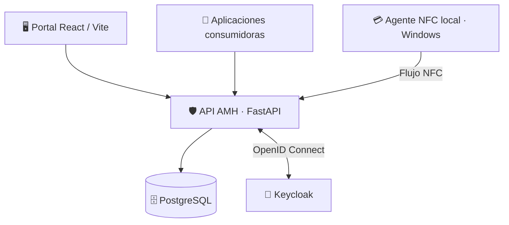

<div align="center">

# 🛡️ AMH
### Access Management Hub

**Identidad centralizada · Acceso a aplicaciones · Administración de usuarios**

Un punto común para gestionar quién eres, a qué aplicaciones puedes acceder y qué permisos tienes en cada una.


[🐙 GitHub](https://github.com/adrcarrui/amh) · [☁️ Azure DevOps](https://dev.azure.com/ATXSimMng/SIA/_git/AMH)

</div>

---

## 🎯 ¿Qué es AMH?

**AMH — Access Management Hub** es un servicio de identidad y administración de accesos para aplicaciones internas. Reúne la información de los usuarios y permite gestionar sus autorizaciones desde un portal común.

Cada usuario mantiene una identidad compartida, con permisos independientes para cada aplicación. Así, una persona puede acceder a mySim Dashboard con un rol determinado y tener otro rol —o el acceso bloqueado— en otra herramienta.

El proyecto vive en un repositorio propio y utiliza una base de datos PostgreSQL dedicada, con migraciones independientes. Las aplicaciones consumidoras se integran mediante la API y los flujos de autenticación de AMH; no consultan directamente sus tablas.

## ✨ Funcionalidades

| | Área | Descripción |
| :---: | --- | --- |
| 👤 | Usuarios | Administración centralizada de identidades y estado de las cuentas. |
| 📧 | Correos | Modelo de correo principal y correos adicionales, con información de verificación. |
| 🧩 | Aplicaciones | Registro de aplicaciones y configuración de sus accesos. |
| 🎚️ | Permisos | Asignación de estado y rol para cada relación usuario–aplicación. |
| 🚫 | Bloqueos | Bloqueo global del usuario o bloqueo de su acceso a una aplicación concreta. |
| 🏠 | Portal | Espacio «My applications» para abrir las aplicaciones autorizadas. |
| 🔐 | Identidad | Inicio de sesión mediante la integración con Keycloak y OpenID Connect. |
| 💳 | NFC | Asignación de tarjetas identificativas y flujo de acceso NFC integrado inicialmente con mySim Dashboard. |
| 🕒 | Sesiones | Gestión de sesiones del portal y de las aplicaciones, con capacidad de revocación. |
| 📝 | Auditoría | Registro de cambios en los estados y roles de acceso. |

## 🏗️ Arquitectura



### 🖥️ Portal web

El frontend está desarrollado con **React, TypeScript y Vite**, con iconos de **Lucide React**. Incluye el espacio de aplicaciones del usuario y las vistas de administración de usuarios y aplicaciones.

La interfaz consulta al backend para obtener la sesión, mostrar las aplicaciones disponibles y realizar las operaciones autorizadas. Las comprobaciones de acceso corresponden al servidor.

### ⚙️ Backend

La API está desarrollada con **FastAPI**. Centraliza la lógica de usuarios, permisos, sesiones, administración e integración NFC.

**SQLAlchemy** proporciona la capa de persistencia y **Alembic** mantiene la evolución del esquema de PostgreSQL mediante migraciones.

### 🔐 Identidad y autenticación

**Keycloak** participa en el inicio de sesión mediante **OpenID Connect**. AMH mantiene la información de negocio necesaria para decidir qué aplicaciones puede utilizar cada usuario y con qué rol.

El portal dispone de su propia sesión. Las sesiones de las aplicaciones se gestionan de forma que puedan revocarse cuando sea necesario.

### 💳 Acceso mediante tarjeta NFC

La lectura física de la tarjeta se realiza mediante un **agente local en el PC Windows**, utilizando el lector **ACR122U**. El navegador interactúa con el agente para obtener la lectura y completar el flujo de acceso.

El agente local ofrece:

| Endpoint | Función |
| --- | --- |
| `GET http://127.0.0.1:8765/health` | Consultar el estado del agente y del lector. |
| `GET http://127.0.0.1:8765/uid` | Leer el UID de la tarjeta presentada. |

El UID identifica la tarjeta. La autorización para entrar en una aplicación depende de las validaciones y permisos establecidos en AMH. La integración NFC inicial está orientada a **mySim Dashboard**; su extensión a otras aplicaciones forma parte de la evolución del proyecto.

## 🧰 Stack tecnológico

| Capa | Tecnología |
| --- | --- |
| API | Python · FastAPI |
| Persistencia | PostgreSQL · SQLAlchemy |
| Migraciones | Alembic |
| Portal | React · TypeScript · Vite |
| Iconos | Lucide React |
| Proveedor de identidad | Keycloak · OpenID Connect |
| Lectura NFC | Agente local Windows · ACR122U |
| Versionado | Git · GitHub · Azure DevOps |

## 📁 Organización del proyecto

Los componentes principales se organizan en estas ubicaciones:

| Ruta | Contenido |
| --- | --- |
| `app/` | Backend, modelos, configuración y rutas de la API. |
| `frontend/` | Portal React/Vite. |
| `migrations/` | Migraciones de la base de datos. |
| `alembic.ini` | Configuración de Alembic. |
| `requirements.txt` | Dependencias del backend. |

El agente NFC se ejecuta en el equipo que tiene conectado el lector. Es un componente local del flujo de acceso.

## 🗄️ Modelo de datos

La base del modelo separa la identidad del usuario de sus autorizaciones:

| Tabla | Responsabilidad |
| --- | --- |
| `users` | Identidad, vínculo con Keycloak y estado global del usuario. |
| `user_emails` | Correos asociados, correo principal y estado de verificación. |
| `applications` | Catálogo y configuración de aplicaciones. |
| `user_application_access` | Estado y rol de cada usuario en cada aplicación. |
| `access_events` | Historial de cambios en las autorizaciones. |

Estas tablas constituyen el núcleo del modelo; las sesiones y los flujos NFC añaden sus propios componentes de persistencia.

### 🎚️ Estados y roles por aplicación

| Estado | Significado |
| --- | --- |
| `pending` | Acceso pendiente de activación. |
| `active` | Acceso habilitado. |
| `blocked` | Acceso bloqueado en esa aplicación. |

Los roles previstos son **`viewer`**, **`editor`** y **`admin`**. Cada aplicación debe aplicar los permisos correspondientes a las acciones de su dominio.

**Ejemplo:** un usuario puede tener acceso `active` con rol `editor` en mySim Dashboard y acceso `blocked` en TAMS, conservando su identidad en AMH.

## 🔗 Integración con aplicaciones

Para incorporar una aplicación al ecosistema:

1. Registrar la aplicación en AMH y configurar los datos necesarios para su integración.
2. Asignar a cada usuario su estado de acceso y su rol.
3. Integrar los flujos de autenticación y sesión correspondientes.
4. Validar los permisos desde el backend de la aplicación consumidora.

**mySim Dashboard** es la integración inicial. **TAMS** y las futuras herramientas internas forman parte del alcance previsto.

## 🛠️ Desarrollo local

El entorno de desarrollo requiere **Python**, **Node.js/npm** y **PostgreSQL**. El inicio de sesión OIDC requiere también un entorno Keycloak configurado; el flujo NFC necesita el agente local y el lector conectado.

Para preparar las dependencias del backend desde PowerShell, en la raíz del repositorio:

```powershell
python -m venv .venv
.\.venv\Scripts\Activate.ps1
python -m pip install -r requirements.txt
```

Una vez configurada la conexión a la base de datos de desarrollo:

```powershell
alembic upgrade head
```

Para preparar y arrancar el portal:

```powershell
cd frontend
npm install
npm run dev
```

El backend debe arrancarse con el punto de entrada definido en el proyecto. La configuración local debe incluir la conexión a PostgreSQL, los parámetros de Keycloak/OIDC, las claves de sesión y las URL de los servicios que intervienen en el flujo.

## 🚀 Evolución prevista

- 🔄 **aTurnos → AMH:** incorporar en AMH los usuarios creados obligatoriamente en aTurnos mediante su API.
- 🧩 **Más aplicaciones:** ampliar la integración a TAMS y nuevas herramientas internas.
- 💳 **NFC reutilizable:** extender el flujo de tarjeta a las aplicaciones que lo necesiten.
- 🎨 **Portal de administración:** continuar mejorando las vistas y el detalle de los usuarios.

Estos puntos son líneas de trabajo; no representan integraciones completas en todas las aplicaciones.

## 🔒 Configuración sensible

Los archivos con credenciales, claves de sesión, tokens o datos personales deben mantenerse fuera del repositorio. Los ejemplos de configuración deben utilizar valores ficticios.

El archivo `.gitignore` debe excluir el entorno virtual, las dependencias instaladas, los archivos `.env` privados y los resultados de compilación.

## 🐙 GitHub + ☁️ Azure DevOps

El esquema de versionado acordado utiliza **GitHub como origen de descarga** y **GitHub y Azure como destinos de envío**:

| Operación | Destino |
| --- | --- |
| `git fetch origin` | GitHub |
| `git pull --ff-only` | GitHub, con la rama configurada para seguir `origin` |
| `git push origin main` | GitHub y Azure DevOps, con las dos URL de envío configuradas |

Los dos destinos se actualizan por separado. Tras cada envío hay que comprobar que ambos han terminado correctamente.

---

<div align="center">

**🛡️ AMH · Access Management Hub**  
Una identidad común. Permisos específicos para cada aplicación.

</div>
